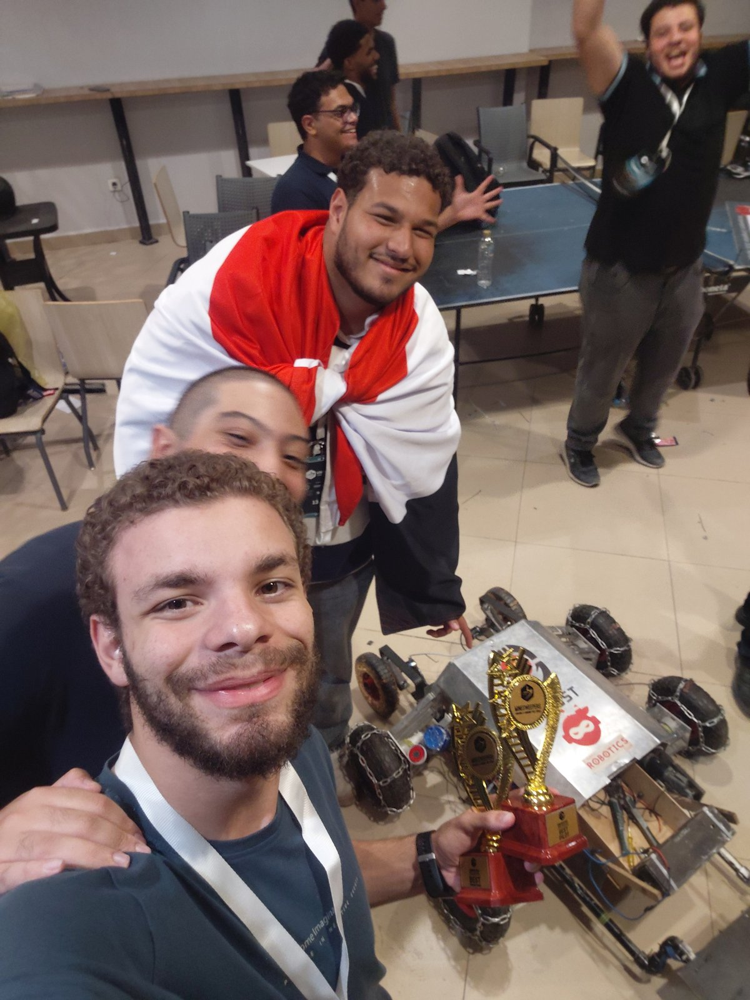
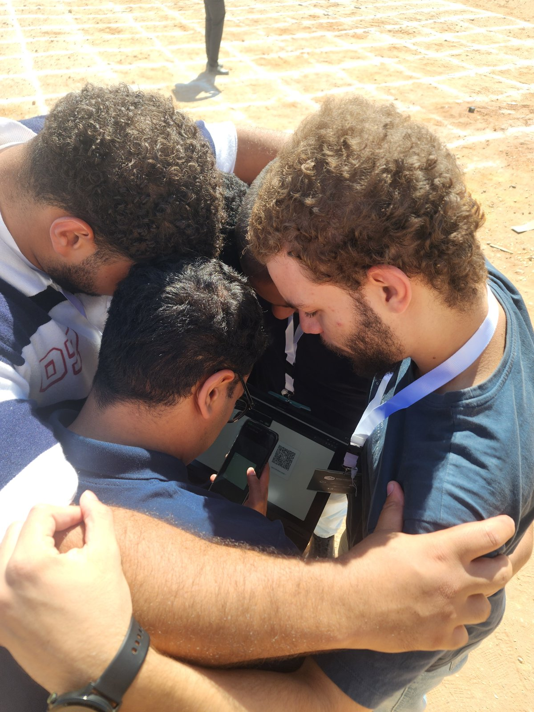
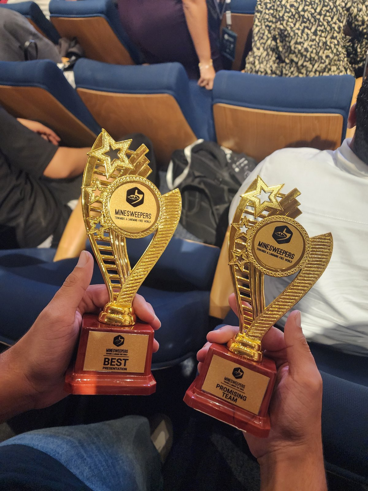

# Minesweepers Autonomous Demining Robot (E-JUST Team B)

**4th Place Nationwide** & **Promising Team Award** — *Minesweepers: Towards a Landmine-Free World* (13th Edition, IEEE RAS Egypt Chapter), held at **Zewail City of Science and Technology**, October 17, 2026.

<p align="center">
  
</p>

## Overview

Built by **E-JUST Robotics Club (Team B)**, this rugged-terrain mobile robot was engineered to navigate uneven simulated minefields, detect both surface and buried anti-personnel landmines, map detected targets, and support electromagnetic retrieval of ferrous objects.

<table>
  <tr>
    <td align="center"><br><em>E-JUST Team B with the 4WD demining robot & Promising Team trophy</em></td>
    <td align="center"><br><em>Live arena telemetry & minefield testing at Zewail City</em></td>
  </tr>
</table>

## Mechanical Design & SolidWorks Subsystems (`CAD/`)

The complete 3D assembly (`CAD/Assem1.SLDASM`) is designed in **SOLIDWORKS** around four modular subsystems:

| Subsystem | Key CAD Assemblies & Parts | Engineering Function |
|---|---|---|
| **Modular Chassis** | `20-2020-BLACK-FB.sldprt`, `30-3030-BLACK-FB.sldprt`, `50cm ex.SLDPRT`, `Upper sheet.SLDPRT`, `Box elec.SLDPRT` | Lightweight, rigid 20×20 mm & 30×30 mm black aluminum extrusion frame with shielded electronics enclosure and L/U brackets |
| **Independent Suspension & Drive** | `shock absorber.SLDASM`, `sprimg.SLDPRT`, `Sus sup.SLDPRT`, `Wheel.SLDPRT`, `Motor draft (1).SLDPRT`, `motor mount.SLDPRT` | 4-wheel off-road drivetrain with spring-damped suspension for rough sand and obstacle traversal |
| **Landmine Detection Coil Frame** | `coil pipe line.SLDASM`, `front coil pipe.SLDPRT`, `front sideways coil pipe.SLDPRT`, `coil back pipe.SLDPRT` | Non-metallic front-mounted pipe structure holding the metal-detection search coil clear of chassis interference |
| **Electromagnetic Retrieval Arm** | `bar with electromagnets.SLDASM`, `Electromagnet.SLDPRT`, `arm.SLDPRT`, `bar.SLDPRT` | Articulated front electromagnet bar for safe pickup and handling of surface ferrous targets |

## Competition Recognition

- **4th Place Overall** — National Academia Category, Minesweepers Egypt 2026 (13th Edition)
- **Promising Team Special Award** — E-JUST Team B

<p align="center">
  
</p>

## Repository Structure

```
minesweepers-demining-robot/
├── README.md
├── LICENSE
├── images/
│   ├── ejust_team_flags.jpg         # E-JUST Robotics Club delegation & robots
│   ├── team_b_robot_trophy.jpg      # Team B with robot and trophy
│   ├── arena_field_testing.jpg      # Minefield arena testing
│   └── promising_team_trophy.jpg    # Minesweepers 2026 Promising Team trophy
└── CAD/
    ├── Assem1.SLDASM                # Full SolidWorks robot assembly
    ├── bar with electromagnets.SLDASM
    ├── coil pipe line.SLDASM
    ├── shock absorber.SLDASM
    └── *.SLDPRT                     # Chassis, brackets, wheels, suspension & enclosure parts
```

## Team & Affiliation

- **Team:** E-JUST Robotics Club — Team B (Egypt-Japan University for Science and Technology)
- **Contributor:** [Mahmoud A. Mohamed](https://github.com/MamoudAlaa) ([LinkedIn](https://www.linkedin.com/in/mahmoud-a-ab2134340))
