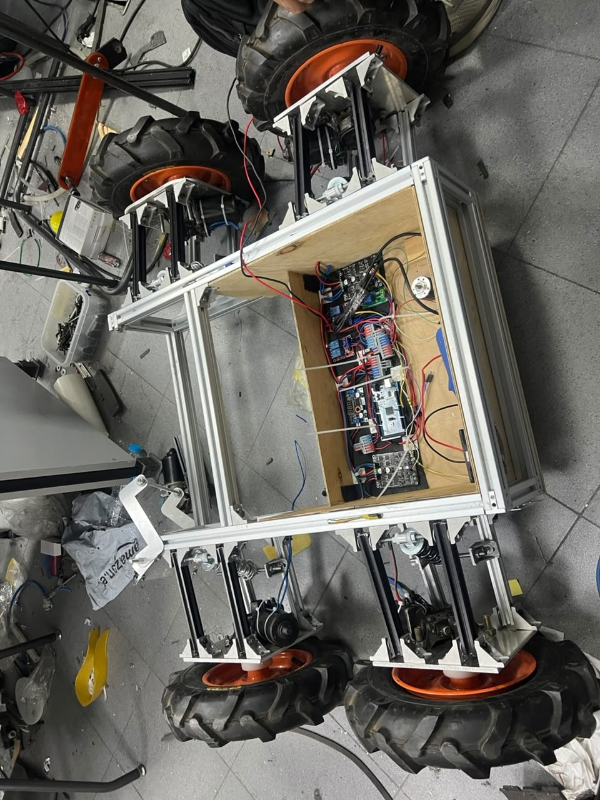
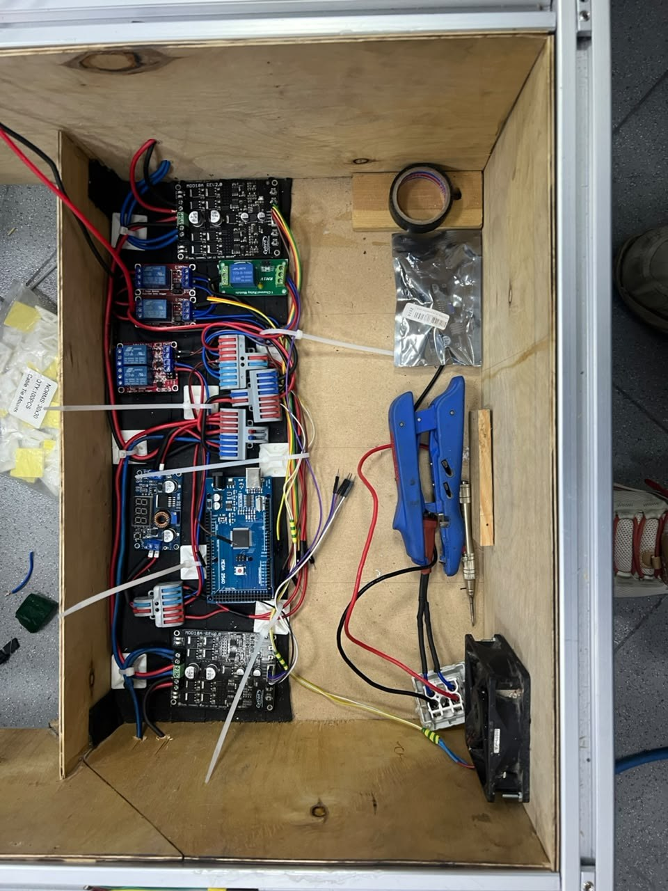
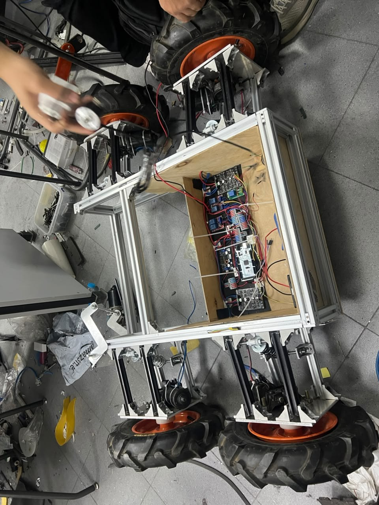
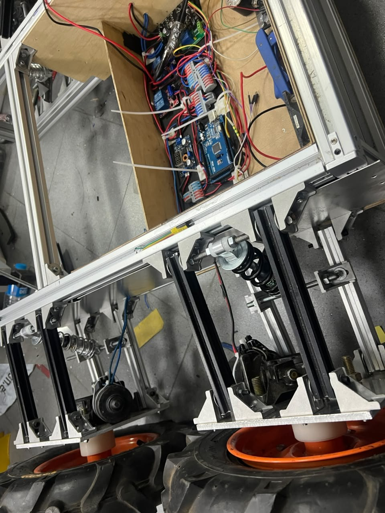
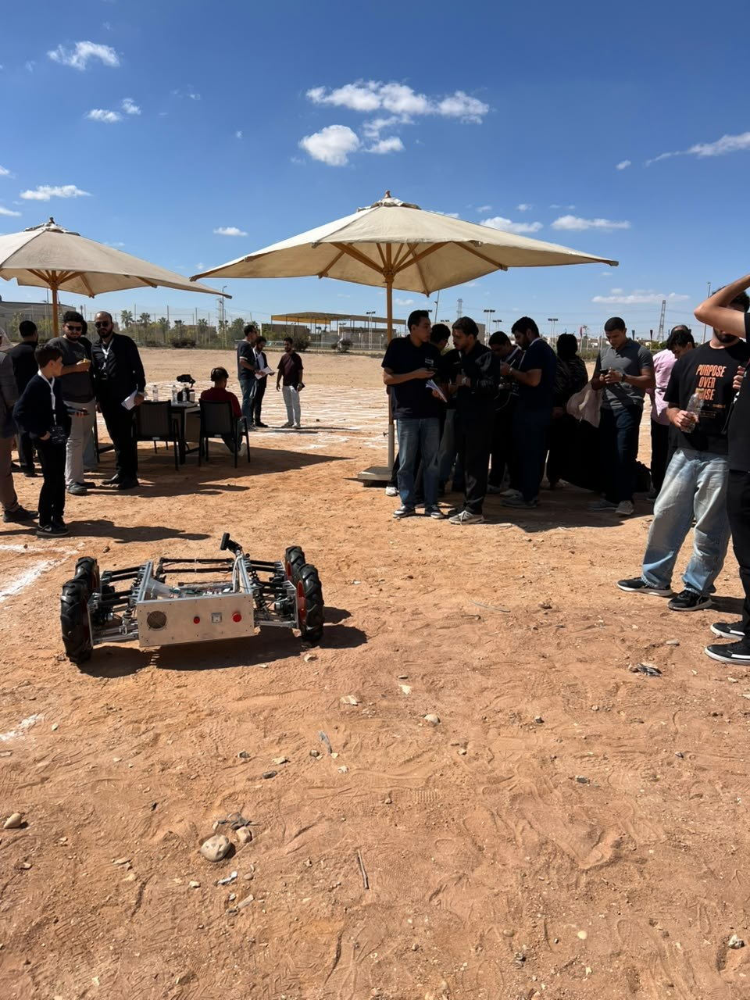
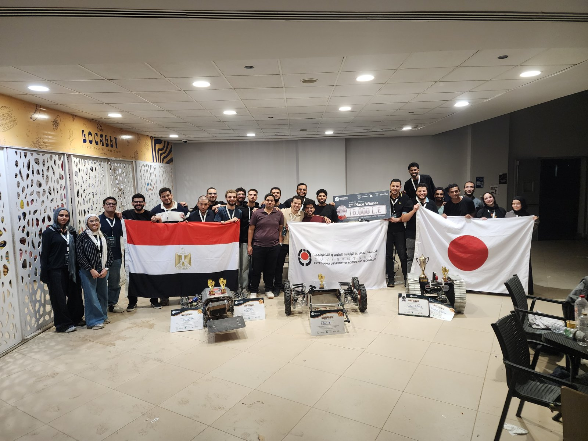

# Minesweepers Autonomous Demining Robot (E-JUST Team B)

**4th Place Nationwide** & **The Spirit of Minesweeper Award (Academia Track)** — *Minesweepers: Towards a Landmine-Free World* (13th Edition, organized by Global Innovation and Entrepreneurship & IEEE RAS Egypt Chapter), hosted at **Zewail City of Science, Technology and Innovation**, October 17, 2026.

<p align="center">
  
</p>
<p align="center"><em>E-JUST Team B's 4WD demining robot competing on the simulated minefield arena at Zewail City</em></p>

## Overview

Built by **E-JUST Robotics Club (Team B)**, this rugged-terrain 4WD mobile robot was engineered to traverse uneven sand and obstacle terrain, detect surface and buried anti-personnel landmines, map target locations, and retrieve ferrous surface objects using an electromagnetic arm.

<table>
  <tr>
    <td align="center"><br><em>Full 4WD aluminum extrusion chassis & off-road wheels</em></td>
    <td align="center"><br><em>Independent linear-guide & spring suspension pods</em></td>
  </tr>
  <tr>
    <td align="center"><br><em>Protected electronics bay (Arduino Mega, custom PCBs, drivers & cooling fan)</em></td>
    <td align="center"><br><em>Official Certificate & "The Spirit of Minesweeper Award" Trophy (E-JUST "B")</em></td>
  </tr>
</table>

## Mechanical Design & SolidWorks Subsystems (`CAD/`)

The complete 3D assembly (`CAD/Assem1.SLDASM`) is designed in **SOLIDWORKS** around four modular subsystems:

| Subsystem | Key CAD Assemblies & Parts | Engineering Function |
|---|---|---|
| **Modular Chassis** | `20-2020-BLACK-FB.sldprt`, `30-3030-BLACK-FB.sldprt`, `50cm ex.SLDPRT`, `Upper sheet.SLDPRT`, `Box elec.SLDPRT` | Rigid 20×20 mm & 30×30 mm aluminum extrusion frame with protected electronics bay (Arduino Mega, custom PCBs, motor drivers, cooling fan) |
| **Independent Suspension & 4WD** | `shock absorber.SLDASM`, `sprimg.SLDPRT`, `Sus sup.SLDPRT`, `Wheel.SLDPRT`, `Motor draft (1).SLDPRT`, `motor mount.SLDPRT` | 4-wheel high-traction off-road drivetrain with independent spring-loaded linear-guide suspension for rough sand and rubble |
| **Landmine Detection Coil Frame** | `coil pipe line.SLDASM`, `front coil pipe.SLDPRT`, `front sideways coil pipe.SLDPRT`, `coil back pipe.SLDPRT` | Non-metallic front-mounted pipe structure holding the metal-detection search coil clear of chassis interference |
| **Electromagnetic Retrieval Arm** | `bar with electromagnets.SLDASM`, `Electromagnet.SLDPRT`, `arm.SLDPRT`, `bar.SLDPRT` | Articulated front electromagnet bar for safe pickup and handling of surface ferrous targets |

## Competition Recognition

- **4th Place Overall** — National Academia Track, Minesweepers Egypt 2026 (13th Edition)
- **The Spirit of Minesweeper Award** — E-JUST "B" (Academia Track)

<p align="center">
  
</p>
<p align="center"><em>E-JUST Robotics Club delegation at Minesweepers 2026</em></p>

## Repository Structure

```
minesweepers-demining-robot/
├── README.md
├── LICENSE
├── images/
│   ├── robot_arena_competition.jpg       # Live minefield arena shot (Zewail City)
│   ├── chassis_full_assembly.jpg         # Full 4WD aluminum extrusion chassis
│   ├── suspension_drivetrain_closeup.jpg # Independent suspension & off-road wheels
│   ├── electronics_bay.jpg               # Arduino Mega, custom PCBs & cooling fan
│   ├── spirit_of_minesweeper_award.jpg   # Official E-JUST "B" Certificate & Trophy
│   └── ejust_team_flags.jpg              # E-JUST Robotics Club delegation
└── CAD/
    ├── Assem1.SLDASM                     # Full SolidWorks robot assembly
    ├── bar with electromagnets.SLDASM
    ├── coil pipe line.SLDASM
    ├── shock absorber.SLDASM
    └── *.SLDPRT                          # Chassis, brackets, wheels, suspension & enclosure parts
```

## Team & Affiliation

- **Team:** E-JUST Robotics Club — Team B (Egypt-Japan University for Science and Technology)
- **Contributor:** [Mahmoud A. Mohamed](https://github.com/MamoudAlaa) ([LinkedIn](https://www.linkedin.com/in/mahmoud-a-ab2134340))
